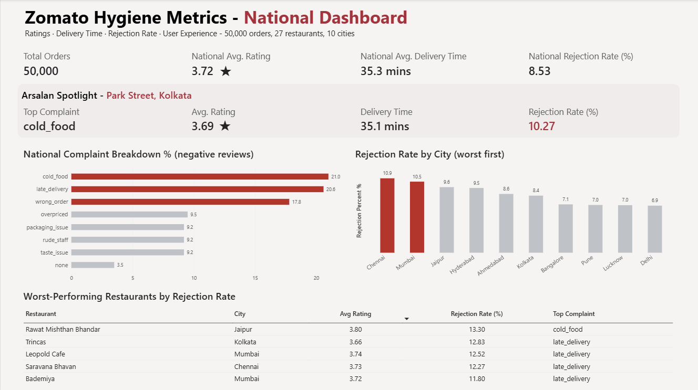

# zomato-hygiene-customer-experience-analytics
A data-driven business analytics case study investigating restaurant hygiene, customer experience, delivery performance and rejection rates across 27 restaurants in 10 Indian cities using Python, Excel and Power BI.

## Power BI Dashboard

The dashboard provides a national overview of restaurant hygiene metrics, customer complaints, delivery performance and rejection rates.

